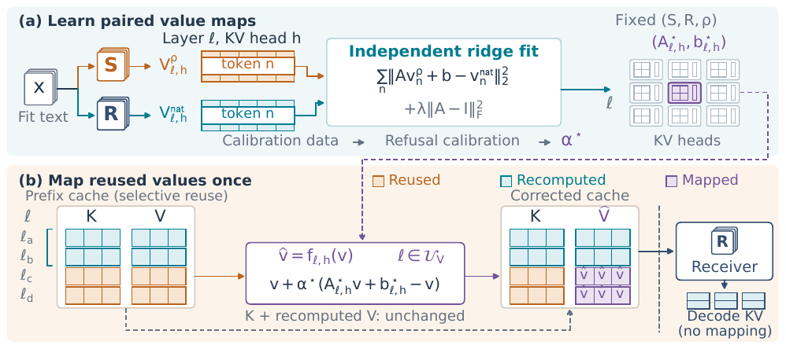

<div align="center">

# VReparo

**Value alignment for safer cross-model KV cache reuse**

[Quick Start](#quick-start) · [Experiments](#reproduce-the-paper) · [Citation](#citation)

[](#installation)
[](LICENSE)

Zhiwei Lin<sup>1</sup> · Jiahao Liu<sup>2</sup> · Yan Liu<sup>2</sup> · Chengpeng Wang<sup>1</sup>

<sup>1</sup>National University of Singapore · <sup>2</sup>Ant Group

</div>

Official implementation of **To Cache or Not to Cache: Understanding and
Mitigating Safety Incompatibility in Cross-Model KV Cache Reuse**.

## Overview

Cross-model KV cache reuse saves prefill computation, but sender-generated
states can change the receiver's safety behavior. **VReparo** learns per-layer,
per-KV-head affine maps that align reused value tensors with receiver-native
values before decoding. The maps are fitted offline and applied once to the
reused prefix; keys, recomputed values, and newly generated KV states remain
unchanged.



This repository provides the value-alignment implementation, Full KV and
DroidSpeak reuse experiments, safety and QA evaluation, and latency measurement.

## Results

Reported paper averages over two model pairs under Full KV and DroidSpeak reuse:

| Safety metric ↓ | Uncorrected reuse | VReparo |
| --- | ---: | ---: |
| HarmBench attack success rate | 57.28% | **39.21%** |
| StrongREJECT score | 0.4215 | **0.2163** |

VReparo retains an average **85.62% TTFT reduction** relative to native receiver
prefill in the paper's resident-cache timing setting. See the
[measurement protocol](docs/PROTOCOL.md) for the evaluated
configurations and timing scope.

## Installation

Run commands from the repository root. Model experiments use **Linux, Python
3.10, CUDA, and an NVIDIA GPU**. The reported mitigation experiments used a
48 GB A40; memory requirements depend on the model pair and evaluator.

```bash
python3 scripts/setup.py
```

Setup creates two isolated environments:

| Environment | Main dependencies | Use |
| --- | --- | --- |
| `.venv-models` | PyTorch 2.4.0, Transformers 4.45.2, PEFT 0.14.0 | Model experiments and data acquisition |
| `.venv-semantic` | PyTorch 2.4.0, Transformers 4.53.3, PEFT 0.14.0 | Qwen3 generation and OR-Bench judging |

Accept access terms for gated models on their provider pages, then authenticate:

```bash
.venv-models/bin/huggingface-cli login
```

Models and datasets are downloaded at pinned revisions when an experiment
starts. See [Data and Models](docs/DATA_AND_MODELS.md) for sources and storage
requirements.

## Quick Start

Inspect the five-run experiment plan without installing dependencies or
starting downloads:

```bash
python3 scripts/run_repeated_mitigation.py --case code_direct --dry-run
```

Run fitting, XSTest calibration, generation, evaluation, and reporting for the
LoRI Code-to-Safety pair with Full KV reuse:

```bash
python3 scripts/run_repeated_mitigation.py \
    --case code_direct \
    --gpu 0 \
    --accept-model-licenses
```

The workflow samples **32 QA + 32 safety examples for each of five seeds**,
fits and calibrates each map separately, and reports individual runs and means.
Repeat the same command to resume completed stages with matching inputs.

Results are written under `outputs/experiments/`; CSV, JSON, and Markdown
summaries are under `outputs/reports/`. Add `--assets /path/to/storage` to place
shared downloads on a larger volume.

## Reproduce the Paper

Each experiment has its own entry script:

| Experiment | Entry point | Paper tables |
| --- | --- | --- |
| Cross-model safety incompatibility | `scripts/run_rq1.py` | 1, 5, 6 |
| Key-only / Value-only / Full KV reuse | `scripts/run_rq2.py` | 2 |
| Five-run VReparo safety and QA evaluation | `scripts/run_repeated_mitigation.py` | 3, 10, 11 |
| XSTest calibration | `scripts/run_calibration.py` | 7 |
| Additional QA evaluation | `scripts/run_quality.py` | 9 |
| TTFT and decode latency | `scripts/run_performance.py` | 4, 8 |
| DroidSpeak recomputation profiling | `scripts/run_profile.py` | Method selection |
| Historical single-fit mitigation | `scripts/run_mitigation.py` | Reference experiment |

For example, run all RQ1 model pairs:

```bash
python3 scripts/run_rq1.py --pair all --gpu 0 --accept-model-licenses
```

The four VReparo cases are `code_direct`, `code_droid`, `base_direct`, and
`base_droid`. Pass `--case all` to cover all cases. RQ1/RQ2 use `--pair` to select
one of the eight configured model pairs. Run GPU workflows sequentially.

See the [Execution Guide](docs/EXECUTION.md) for full commands and
[Five Runs](docs/FIVE_RUNS.md) for sampling and calibration details.

### Check the reported tables without a GPU

Included sanitized observations can reconstruct the eleven paper tables using
only Python 3.10 or newer:

```bash
python3 run.py verify
python3 run.py reproduce
```

`verify` checks **11 tables, 94 rows, and 856 displayed cells**. `reproduce`
writes CSV and Markdown tables to `outputs/all/`. This check recomputes saved
observations; fresh model generation and judging use the experiment scripts.

## Project Structure

```text
scripts/                 Experiment entry points, environment setup, downloads
experiments/             Model pairs, cases, sampling, pinned resource recipes
src/                     Value mapping, KV reuse, generation, scoring, workflows
data/                    Sanitized observations for table reconstruction
expected/                Paper table values used for comparison
assets/                  Method illustration from the paper
docs/                    Experiment protocols and detailed guides
tests/                   Numerical, workflow, and integrity tests
manifests/               Source and data provenance, file checksums
outputs/                 Local downloads, checkpoints, and reports
```

Raw benchmark prompts, model weights, and fitted tensors are acquired or
produced locally. They are excluded from the project upload package.

## Documentation

- [Execution Guide](docs/EXECUTION.md)
- [Data and Models](docs/DATA_AND_MODELS.md)
- [Five-Run Protocol](docs/FIVE_RUNS.md)
- [Metrics and Timing Protocol](docs/PROTOCOL.md)
- [Reproducibility and Validation](docs/REPRODUCIBILITY.md)

The full GPU experiment matrix has not been rerun for this project packaging
pass. Verification details and environment coverage are recorded in
[Validation](docs/VALIDATION.md).

## Citation

If you use VReparo, please cite the accompanying paper:

```bibtex
@unpublished{lin2026vreparo,
  title  = {To Cache or Not to Cache: Understanding and Mitigating Safety
            Incompatibility in Cross-Model KV Cache Reuse},
  author = {Lin, Zhiwei and Liu, Jiahao and Liu, Yan and Wang, Chengpeng},
  year   = {2026}
}
```

## License

Original project code is released under [MIT](LICENSE). Third-party components
retain their own terms; see [NOTICE](NOTICE.md) and
[Third-Party Components](docs/THIRD_PARTY.md). The paper and its illustration
are outside the code license grant.
